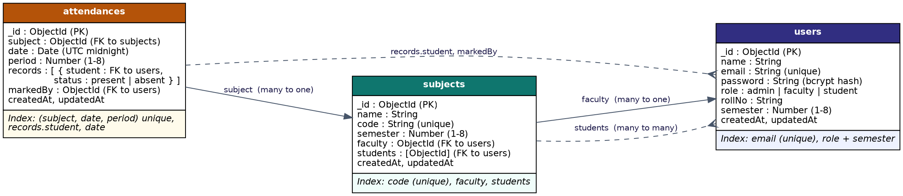

# AttendIQ - Database Schema

Database: MongoDB (Atlas), name `attendance_db`, accessed through Mongoose.
Diagram: `docs/er-diagram.png`

## Collections

### users
| Field | Type | Rules |
|---|---|---|
| _id | ObjectId | primary key |
| name | String | required, 2 to 60 characters |
| email | String | required, unique, lowercase, valid format |
| password | String | required, min 6, stored as bcrypt hash, hidden from queries by default |
| role | String | `admin`, `faculty` or `student` (default `student`) |
| rollNo | String | optional (students) |
| semester | Number | 1 to 8, optional |

### subjects
| Field | Type | Rules |
|---|---|---|
| _id | ObjectId | primary key |
| name | String | required |
| code | String | required, unique, uppercase |
| semester | Number | required, 1 to 8 |
| faculty | ObjectId | `ref: "User"`, required |
| students | [ObjectId] | `ref: "User"`, enrolled students |

### attendances
| Field | Type | Rules |
|---|---|---|
| _id | ObjectId | primary key |
| subject | ObjectId | `ref: "Subject"`, required |
| date | Date | required, stored at UTC midnight |
| period | Number | required, 1 to 8 |
| records | [ { student: ObjectId (ref User), status: "present" or "absent" } ] | embedded array, one entry per student |
| markedBy | ObjectId | `ref: "User"` |

## Relationships

| From | To | Type | Field |
|---|---|---|---|
| subjects | users | many to one | `faculty` |
| subjects | users | many to many | `students[]` (enrollment) |
| attendances | subjects | many to one | `subject` |
| attendances | users | many to many | `records.student` |
| attendances | users | many to one | `markedBy` |

`populate()` is used to replace these references with real documents (for example the faculty name inside a subject).

## Indexes (database optimization)

| Collection | Index | Why |
|---|---|---|
| users | `email` (unique) | login lookup and duplicate protection |
| users | `role, semester` | admin list filters |
| subjects | `code` (unique) | no duplicate subject codes |
| subjects | `faculty`, `students` | "my subjects" queries for faculty and students |
| attendances | `subject, date, period` (unique) | same lecture cannot be marked twice, and fast sheet lookup |
| attendances | `records.student` | student attendance aggregation |
| attendances | `date` | 30-day trend on the dashboard |

## Aggregation pipelines

| Used for | Stages |
|---|---|
| Student subject-wise percentage | `$match` student, `$unwind` records, `$match` again, `$group` by subject (present and total), `$lookup` subjects |
| Subject summary and at-risk list | `$match` subject, `$unwind` records, `$group` by student |
| Dashboard | `$group` by subject, by student, by date (30 days) and users by role |
